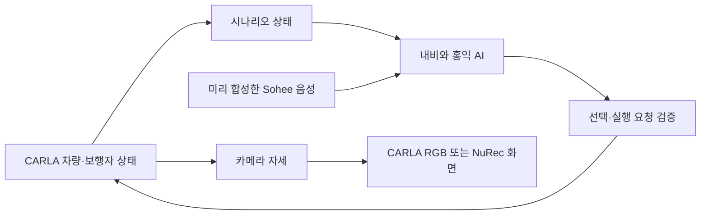

# 홍익 DRIVE 중간발표 준비용 개발 현황

작성 기준: 2026-11-03 / 발표 준비: 2026-11-04

## 1. 프로젝트를 한 문장으로

**자율주행 차량의 행동이 승객에게 불안하거나 답답하게 느껴질 때, 승객이 어느 정도의
정보를 확인하고 어떤 대응까지 선택하는지 살펴보기 위한 상호작용 시뮬레이터를 만들고 있다.**

핵심은 운전 성능의 우열을 증명하는 것이 아니라, 승객이 상황을 이해하고 대응을 요청한 뒤
그 결과를 확인할 수 있도록 만드는 것이다. 현재는 개발 시제품이며 참가자 연구 결과는 아니다.

## 2. 지금까지 만든 것

- **공통 내비게이션:** Tesla 스타일의 차량·지도 화면, 기존 로컬 음악 플레이어, 홍익 AI 알림.
- **상황 설명과 대응:** 알림을 누르면 Sohee가 설명하고, 세로 선택지와 실행 확인을 제시한다.
  버튼을 살펴보거나 선택한 것만으로 차량이 행동하지 않는다.
- **행동 결과:** 경적·상향등·거리 확보·인물 반응 등을 실제 장면에 반영하고 결과를 관찰한 뒤
  정차·종료 메시지를 남긴다. 단순한 팝업 목업만 만든 상태가 아니다.
- **두 렌더링 경로:** CARLA 자체 도로·차량·사람을 쓰는 버전과 NuRec 실사 재구성 버전을 별도로 유지한다.
- **소리:** Sohee 설명, 외부인 대사, 발소리·문 두드림, 불규칙한 하부 커버 접촉음,
  속도에 따라 달라지는 주행·환경음을 연결했다.
- **모바일:** iPhone 연결·QR·알림·선택을 PC 주행에 전달하는 경로를 구현했다.
  이전 실기기 시험에서 알림과 명령 반영을 확인했다. 새 조건과 현장 Wi-Fi에서는 다시 점검해야 한다.
- **기록:** 상황 발생·UI 노출·설명 열기·선택·실행·완료 시점을 기록하고 코드와 설정을 GitHub에 관리한다.

## 3. 구현된 상황과 현재 선택지

각 상황은 독립적으로 실행한다. 아래는 현재 코드 기준이며 초기 기획의 선택지와 일부 다르다.

| 상황 | 연출 | 현재 대응 |
|---|---|---|
| 4차로 답답한 주행 | 느린 앞차, 오른쪽 대형차, 왼쪽 빠른 차량 흐름 | 하이빔 / 클락션 / 차간 거리 넓히기 / 그냥 유지 |
| 야간 불안정한 앞차 | 우리 차는 차로 유지, 가까운 앞차가 경계 주변에서 흔들림 | 클락션 / 차간 거리 넓히기 / 그냥 유지 |
| 짙은 안개 | 출발 10초 후부터 약 5초 동안 짙어지는 시야 제한 | 안전조치 확인 / 더 감속·거리 확보 / 안전한 곳 정차 요청 |
| 보행자와 서로 양보 | 반 걸음 내딛고 물러서며 손짓하는 사람 앞에서 정차 | 클락션 / 하이빔 / 직접 대응 / 기다리기 |
| 카풀 대기 중 외부인 접근 | 차량을 택시로 착각한 인물이 다가와 소리치고 문을 두드림 | 다른 장소로 이동 / 외부 스피커 경고 / 가만히 있는다·직접 대화 / 클락션 |
| 주행 중 반복 이상음 | 차 아래에서 불규칙한 달그락·딸깍 소리 | 상태 점검 / 관제 지원 / 안전한 곳 정차 요청 / 현재 주행 유지 |

CARLA 자체 버전은 위 여섯 상황을 선택한다. NuRec 선택 화면에는 4차로·야간 앞차·안개·이상음과
새 **야간 보행자 양보**가 있다. 카풀의 외부인 접근을 NuRec에서도 완성했다고 발표하면 안 된다.

NuRec 정차 요청은 확인된 정차 공간이 없으면 감속으로 대응하며 갓길 정차 성공을 가장하지 않는다.
관제 응답은 모의 응답이다. 직접 대응은 음성 이해가 아니라 승객의 완료 버튼으로 진행한다.

## 4. 구현 방법을 쉽게 설명하면

### CARLA 자체 버전

CARLA가 도로·차량·사람·날씨를 만들고 물리 이동과 카메라 화면을 함께 처리한다.
차량 위치를 매번 순간이동시키는 대신 조향·가감속으로 움직이고, 사람은 WalkerControl로 이동한다.
망설임과 손짓은 정해진 동작이다. 같은 인물의 기본 걷기 동작을 활용해 관절이 튀는 문제를 줄였다.

### NuRec 버전

CARLA가 실제 차량 위치와 주행 상태를 계산하면 그 카메라 자세를 NuRec에 전달한다.
NuRec은 사용권이 확인된 원본 장면에서 해당 시점·시점 위치의 실사 재구성 화면을 만든다.
원본의 경로와 촬영 범위에 제약이 있으며 임의로 길을 끝없이 확장한 것은 아니다.

이번 야간 보행자 조건은 **NuRec의 원래 야간 배경 + CARLA의 제어 가능한 보행자**를 결합했다.
같은 순간의 RGB·인스턴스 ID·깊이 영상과 렌즈 보정값을 사용하고, 사람 뒤의 배경까지 함께 가려지지
않도록 처리했다. 횡단 구간은 실험용 추가 요소다. 원본 장소의 실제 횡단보도를 복원했다는 뜻은 아니다.

### 내비와 실행 연결

명령에는 현재 세션과 요청 ID를 붙인다. 이전 상황의 버튼이 뒤늦게 실행되거나 같은 경적이
중복 요청으로 여러 번 울리지 않게 확인한다. 장면과 내비는 같은 상태를 보고 갱신한다.

## 5. ‘홍익 AI’와 음성은 실제로 무엇인가

현재 설명은 **시나리오의 정해진 상태를 읽는 설명 시스템**이다. 자유 대화 LLM이나 YOLO가
실시간으로 앞차의 의도를 판단해서 설명하는 상태는 아니다. 초기에는 음성 호출과 제스처도
탐색했지만, 현재 주 실험 흐름은 상황 알림을 승객이 직접 누르는 방식이다.

Sohee는 Qwen3-TTS 0.6B로 미리 합성한 설명을 재생한다. 반복 대사를 캐시해 응답 지연을 줄였다.
우리 대화로 모델을 재학습했다는 뜻은 아니다. 외부인 대사는 별도 Aiden 합성 음성이며 실제 취객
녹음이 아니다. 음악·환경음은 설명 중 줄어들도록 연결했다.

## 6. 연구 질문과 인터페이스 설계의 연결

| 보고 싶은 행동 | 인터페이스에서 관찰할 수 있는 것 |
|---|---|
| 알림만 확인하고 맡기는가 | 알림 노출 후 설명을 열지 않음 |
| 차량이 왜 기다리는지 알고 싶은가 | 설명 열기·닫기·다시 듣기 |
| 대응을 직접 요청하는가 | 선택지 열기·선택·취소·실행 |
| 어느 종류의 대응을 고르는가 | 안내·주행 변경·직접 대화 등 선택 종류 |
| 실행 결과를 어떻게 받아들이는가 | 결과 확인 이후 후속 질문·설문으로 확인할 계획 |

버튼을 세로로 나열하고 동일한 크기·색으로 제시해 숫자 단계처럼 보이는 인상을 줄였다.
보행자·카풀·이상음 조건은 ETA를 숨겨 가장 빨리 도착하는 답을 유도하지 않도록 했다.
이것만으로 편향을 제거했다고 단정하지 않는다. UI 노출 시간은 실제 시선·이해 시간을 의미하지 않는다.

## 7. 현재 확인한 것과 남은 한계

**확인:** 실제 CARLA와 NuRec 연결, 기존 내비와 명령 전달, 보행자 정차·횡단·재출발·종료,
클락션과 하이빔 결과, 실제 브라우저에서 Sohee 설명과 세로 선택지 표시.
관련 자동 검사는 개발 단계의 회귀 검사이며 참가자 실험을 대신하지 않는다.

**남은 한계:** NuRec은 촬영 경로 바깥·가까이 옮긴 물체에서 재구성 이질감이 생길 수 있다.
추가한 보행자는 게임 모델이므로 실사 사람과 질감·조명·접촉 그림자가 완전히 같지 않다.
현재 540p 야간 보행자 시험에서는 정차 반응 구간 약 16 FPS, 이동 중 약 3~4 FPS를 관측했다.
30 FPS는 목표 상한이며 안정적으로 달성한 결과가 아니다. 조건이 다른 전체 시나리오 성능을
같은 수치로 일반화하면 안 된다.

오래 대기한 뒤 CARLA 프로세스가 종료된 사례가 있어 재시작했다. 종료 원인은 확인하지 못했다.
장시간 안정성, 연구실 GPU·3면 화면 동시 구동, 새 조건의 iPhone 연동, 참가자 평가가 더 필요하다.
현재 NuRec 촬영지는 국내 정밀지도로 완성한 서강로 복제맵이 아니다.

## 8. 발표에서 보여줄 순서

1. **문제:** 차량은 기다리는 것이 맞는데 승객은 왜 답답하거나 불안할까?
2. **연구 방향:** 정보를 어디까지 보고 어떤 대응까지 요청하는지 비교한다.
3. **공통 흐름:** 상황 → 홍익 AI 알림 → 설명 → 세로 선택지 → 실행 → 결과.
4. **짧은 시연:** 보행자 양보 또는 카풀 대기 한 장면으로 전체 흐름을 보여준다.
5. **구현:** CARLA 제어와 NuRec 표현을 구분하고, 현재는 정해진 상태 기반 설명임을 밝힌다.
6. **다음:** 안정적인 조건을 먼저 고정하고 장비·자극·로그를 파일럿으로 검증한 뒤 참가자 연구를 진행한다.

추천 마무리 문장: “현재는 승객이 설명을 보고 대응을 요청하면 장면의 결과까지 이어지는
시제품을 구현했습니다. 다음 단계는 자극과 실행 환경을 고정하고, 실제 사용자가 얼마나
정보를 확인하고 어느 대응까지 요청하는지 평가하는 것입니다.”

## 9. 시연 실행과 근거 자료

- CARLA 자체 여섯 상황: `Start-CARLA-Native.bat` 또는 수업 폴더 50번.
- NuRec 선택 화면: 기존 48번 또는 `open_app.py`; 야간 보행자는 **05 야간 보행자 양보**.
- 같은 8774 포트를 사용하므로 CARLA 자체 버전과 NuRec 버전을 동시에 실행하지 않는다.
- 공개 코드: https://github.com/jungmin5589-del/hongik-carla-hmi
- [야간 보행자 구현·검증](NUREC-NIGHT-PEDESTRIAN-KO.md)
- [음악 내비와 현재 카풀 대응](PASSENGER-NAVIGATION.md)
- [주행·환경음과 보행자 움직임](AMBIENCE-PEDESTRIAN-KO.md)
- [NuRec 원본 교통을 유지한 안개·이상음](NATURAL-NUREC-KO.md)
- [설정과 실행 구성](SETUP.md)

원본 모델·음성·실험 영상·인증정보는 공개 저장소에 넣지 않는다. 시연 영상과 상세 검증 자료는
별도의 로컬 폴더에 보관한다. 발표 자료를 외부 공개할 때에는 각 자료의 이용 조건을 확인한다.
